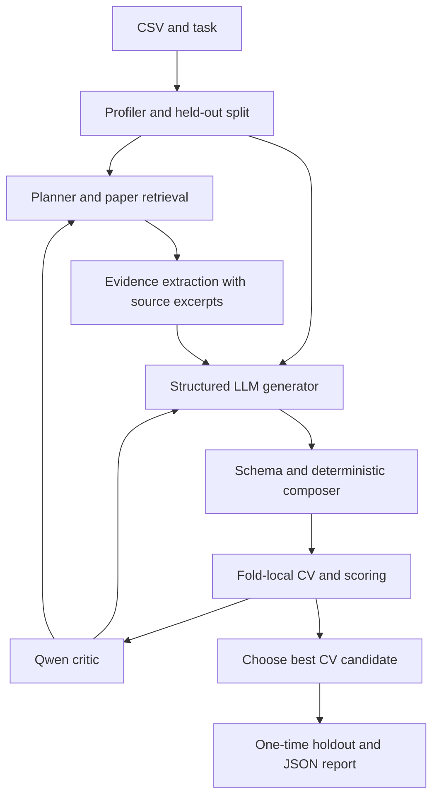

## NEW: Matched-budget, frozen-literature, multi-seed A/B/C/D study

See **[CONTROLLED_ABCD_STUDY.md](CONTROLLED_ABCD_STUDY.md)** for the pre-specified protocol, Windows commands, row-aligned prediction CSVs, paired bootstrap uncertainty intervals, and limitations. Prior CBIS-DDSM pilot reports are preserved in `examples/pilot_cbis_20261119/`.

```powershell
python -m scripts.run_controlled_abcd --dataset cbis --seeds 42 52 62 72 82 --budget 6 --max-iterations 9 --suite-id cbis_repeated_v1
python -m scripts.analyze_controlled_abcd --suite experiments/controlled/cbis_repeated_v1 --bootstrap 2000
```

---

## New: shared readable JSON literature library

All recovered and newly retrieved papers are saved as **one readable JSON per paper** in the shared `<AgenticAI>/RAG_Knowledge_Base/papers` folder. Run `python -m scripts.restore_literature --summary` to create and inspect the 85 restored paper records. See [PAPER_JSON_KNOWLEDGE_BASE.md](PAPER_JSON_KNOWLEDGE_BASE.md) for Windows path, historical archive import, verification checks, and disaster recovery.

# Ruoxin Level 2 — Literature-Guided Automated Model Composition

## Recovered, persistent literature knowledge base (NEW)

This distribution includes a **prepopulated SQLite knowledge repository** built
by auditing all available historical pipeline archives and A/B/C/D reports.
The recovered seed contains 78 original paper abstracts, 21 abstract-matched
method excerpts and 11 additional historical claims kept for verification.
It is automatically initialized in `~/.agentic_research_kb/` and survives
upgrading or extracting another ZIP. New tasks reuse the saved papers and, by
default, also attempt incremental online discovery for previously unseen queries.

**Read [`LITERATURE_KNOWLEDGE_BASE.md`](LITERATURE_KNOWLEDGE_BASE.md)** for exact
commands to import the complete history from older Windows `AgenticAI` folders,
list database counts, freeze a reproducible corpus, and run CBIS-DDSM or WDBC
Experiment D without live retrieval. The ZIP already includes offline frozen
CBIS and WDBC research snapshots in `examples/`.


Research prototype derived from Ruoxin's uploaded `controller.py`, `profiler.py`,
`planner.py`, `retriever.py`, `deep.py`, `trainer.py`, `evaluator.py`, `qwen.py`,
`scoring.py`, `registry.py`, `schemas.py`, and `config.yaml`.

**Level 2** means an LLM chooses *what to compose* from a constrained registry.
Trusted, deterministic Python constructs, validates, and cross-validates the
actual models. The LLM **never writes or executes arbitrary Python**.

This is a research prototype for tabular **classification**, not a clinical
breast-cancer diagnostic device. Literature evidence is advisory; paper abstracts
alone do not establish that a proposed method will outperform a baseline.

## Architecture



## Four supported architectures

| `composition.kind` | Constructed sklearn object | Key constraint |
|---|---|---|
| `pipeline` | `Pipeline([transforms..., estimator])` | 1 registered classifier |
| `feature_union` | `FeatureUnion` of 2–3 transform branches, then classifier | No classifiers inside branches |
| `voting` | `VotingClassifier` with 2–3 feature/model branches | Soft voting requires probabilities |
| `stacking` | `StackingClassifier` with 2–3 branches and CV-trained meta-model | Inner CV = 3; no out-of-fold shortcut |

Allowed transforms: `standard_scaler`, `minmax_scaler`, `robust_scaler`,
`select_k_best`, `rfe`, `pca`, `polynomial_features`, `variance_threshold`.
The supported estimators come from `ml/registry.py`: logistic regression,
random forest, extra trees, gradient boosting, histogram gradient boosting,
SVC, KNN, and decision tree. Nested composition is deliberately bounded.

### Declarative candidate example

```json
{
  "rationale": "Fuse low-dimensional and selected representations",
  "preprocessing": {
    "numeric_imputer": "median",
    "numeric_scaler": "standard",
    "categorical_encoder": "onehot",
    "drop_columns": []
  },
  "model": null,
  "composition": {
    "kind": "feature_union",
    "branches": [
      {"name": "pca", "transforms": [
        {"op": "pca", "params": {"n_components": 8}}]},
      {"name": "selection", "transforms": [
        {"op": "select_k_best", "params": {"k": 12}}]}
    ],
    "model": {"name": "logistic_regression", "hyperparameters": {"max_iter": 1000}}
  },
  "evidence_ids": ["ev_actual_id_from_evidence_json"],
  "research_basis": ["Verifiable related paper title"]
}
```

The example evidence ID above is illustrative and must be replaced with an ID
from the **current** `evidence.json`; the generator rejects nonexistent IDs.

## Install and run

Python 3.10+ is recommended. Run from the package root so imports resolve.

```bash
python -m venv .venv
source .venv/bin/activate       # Windows: .venv\Scripts\activate
python -m pip install -r requirements.txt
python -m unittest discover -s tests -v
python -m examples.offline_wdbc_demo
```

The offline Wisconsin Diagnostic Breast Cancer demo uses sklearn's public
dataset, no network or Ollama. It compares a forest, feature-selection pipeline,
feature union, and soft-voting ensemble with CV, then evaluates the single
CV-selected model on a held-out test set. It explicitly encodes **malignant=1**.

For the full LLM + literature loop, install [Ollama](https://ollama.com/), then
pull the model names in `config.yaml` (or edit them to installed local models):

```bash
ollama pull qwen3.5:4b
ollama pull qwen3:4b
python main.py --csv path/to/dataset.csv --target malignant \
  --task "Predict malignant versus benign Wisconsin diagnostic breast cancer tumors" \
  --config config.yaml
```

Set `cv.positive_label: 1` after making sure malignant is in fact encoded as 1
in the CSV. Other datasets must use their own actual target mapping. For a
paper, report malignant sensitivity, specificity, calibration, uncertainty,
generalization across external cohorts, and subgroup robustness, not merely
accuracy on one small benchmark.

### RAG ablation

```bash
python main.py --csv path/to/dataset.csv --target malignant \
  --task "Wisconsin breast cancer diagnosis" --config config_no_rag.yaml
python main.py --csv path/to/dataset.csv --target malignant \
  --task "Wisconsin breast cancer diagnosis" --config config.yaml
python -m examples.compare_runs \
  --rag experiments/runs/RAG_RUN_ID \
  --control experiments/runs/NO_RAG_RUN_ID
```

Both configs use the same split seed, folds, scoring, candidate budget and
generator settings. LLM sampling can still differ; serious ablations require
multiple datasets/seeds and a *fixed number of evaluated candidates* (the
current controller can skip duplicates). Do not tune on the holdout, and do not
claim a RAG advantage merely because its CV score is slightly higher.

## What is preserved from the original implementation?

- `orchestration/controller.py`: outer loop, baseline, patience, one holdout.
- `data/profiler.py`: stratified split and train-only feature summary.
- `rag/planner.py` and `rag/retriever.py`: planned arXiv/Semantic Scholar
  retrieval, plus biomedical PubMed abstracts when appropriate.
- `agents/deep.py`: Qwen generator, now proposing compositional JSON.
- `agents/qwen.py`: structured critic and feedback loop.
- `ml/trainer.py`, `ml/scoring.py`, `ml/evaluator.py`: fold-local pipelines,
  repeated stratified CV, final evaluation.
- `ml/registry.py`: allowlisted sklearn classifiers.

New: `ml/composer.py` (trusted compiler), `rag/evidence.py` (verbatim abstract
excerpt validation + method records), `agents/schemas.py` composite schema,
`orchestration/reporter.py` (PDF summary), tests, an offline demo, and paired-run
descriptive comparator.

## Research evidence provenance and limitations

The retriever outputs paper title, URL, year, source and DOI where available.
The evidence extractor returns a short *verbatim abstract excerpt*, method,
hypothesis, suggested registered operations, limitations and a stable evidence
ID. Extracted methods must appear in the source abstract. Only the LLM-based
extractor marks `extraction_method=llm_verified_excerpt`. If Ollama is absent,
the fallback is **keyword-only**, labeled `keyword_fallback` and is **not** an
equivalent scientific evidence review. Check abstracts and cited original
papers manually before publication; abstracts may be truncated, and findings
on a different cohort do not prove transferability to Wisconsin data.

Nothing from a paper is executed. The generator's proposed evidence IDs must
match retrieved records. `ml/composer.py` rejects unknown operators,
parameters, oversized polynomial expansions, unsupported configurations,
resource-unbounded ensembles, and invalid model structures. Transformation
steps are inside sklearn pipelines and fit on each CV training fold; this
prevents selecting features on held-out observations.

## Important caveats and follow-up work

1. `FeatureUnion`/PCA/feature selection is most reliable initially on fully
   numeric tabular data (such as Wisconsin Breast Cancer). On a categorical
   dataset, one-hot encoding can expand feature counts; add dynamic post-encode
   dimension limits and more systematic sparse support before broad use.
2. The limited Wisconsin diagnostic dataset has near-ceiling performance for
   many classical classifiers. Distinguish research novelty in *search-policy
   efficiency, evidence use, and calibration* from tiny accuracy differences.
3. The current prototype trains only classifiers in the fixed registry. It does
   not autonomously invent mathematical algorithms (Level 3).
4. Stacking uses sklearn's cross-fitting internally, inside the outer training
   folds, and is more computationally expensive than a single estimator.
5. For a defensible paper, freeze code, dependencies, splits and literature
   snapshots; retain detailed run artifacts; compare same candidate budgets;
   report paired uncertainty across multiple datasets. External validation
   and clinical governance are mandatory before any real diagnostic use.
6. No-RAG mode uses the same generator and critic but no retrieved papers; the
   workflow remains operational even when RAG network calls fail.

Saved `experiments/runs/<timestamp>/` outputs include profile, query plan,
retrieved abstracts, evidence extraction, candidate JSON, evaluation results,
critic feedback, final JSON report, and an optional PDF summary. The original
upload did not include `reporter.py`, so this package implements a compatible
reporter.

---

## Evidence-to-Experiment Engine — new Level 2 extension (November 2026)

The original RAG run extracted 15 records but evaluated no evidence-derived
composition. This release adds a *deterministic and auditable* translation path:

`retriever.py → evidence.py → evidence_compiler.py → evidence_integration.py → composer.py → trainer.py`

### Behavior

- `rag/evidence_compiler.py` checks that the exact quoted source excerpt
  supports the operation being mapped. Generic `feature selection` can map to
  a documented experiment using `SelectKBest`; it **cannot** be claimed to
  specify RFE unless the excerpt explicitly mentions RFE.
- The compiler currently supports actionable compositions for feature selection
  (RFE, generic selection, PCA, low-variance filtering, polynomial features),
  voting, and stacking. Default classifier choices and hyperparameters are
  recorded as *experimenter choices*, not misattributed paper facts.
- Image/segmentation methods from MRI, ultrasound or whole-slide papers are
  rejected for numeric tabular WDBC. Techniques requiring unsupported sampling
  or synthetic data generation are not silently approximated.
- Only `llm_verified_excerpt` evidence can trigger automated composition by
  default. The label means excerpt-substring checking succeeded, **not** that
  the publication's claims or clinical applicability were independently verified.
- `orchestration/evidence_integration.py` reserves 1 of the **existing** 3
  candidates per iteration for evidence-derived composition when a suitable
  novel method exists. The other 2 candidates remain LLM-generated. If no
  eligible method exists, the LLM retains all 3 slots. There are never more
  than 3 candidates per iteration as a result of enabling RAG.
- Invalid architectures and unjustified citations are rejected, not silently
  rewritten. The controller still evaluates using CV and selects using only
  training-side results; the holdout is evaluated once at the end.
- Original Qwen critic remains configurable and may drive follow-up retrieval.

### First-time setup

```bash
python -m pip install -r requirements.txt
python -m unittest discover -s tests -v
python -m examples.offline_evidence_demo
```

For a live run, install Ollama separately and ensure `qwen3.5:4b` and `qwen3:4b`
are locally available, or change the configured model tags to installed ones.
The offline tests/demo require no Ollama or network access.

Using Ruoxin's supplied WDBC CSV from the project root:

```bash
python main.py --csv "data/data-2.csv" --target diagnosis \
  --task "Predict malignant versus benign using numeric WDBC tumor measurements" \
  --config configs/C_rag_evidence_compiler.yaml
```

If your CSV is elsewhere, change the `--csv` path. The example configurations
exclude the identifier column `id` *for all arms*; if the dataset has no such
column, change `data.exclude_columns` to `[]` consistently across arms.

### Four controlled treatments

- `configs/A_no_rag.yaml`: no RAG, no evidence extraction, LLM Level-2 search.
- `configs/B_rag_context_only.yaml`: RAG and extracted evidence in LLM context,
  but no deterministic evidence-to-model compiler (prior RAG behavior).
- `configs/C_rag_evidence_compiler.yaml`: RAG + evidence extraction + deterministic
  evidence-to-composition compiler (new treatment).
- `configs/D_no_rag_level2.yaml`: Level-2 generator without RAG (control variant).

Because A and D both leave the general Level-2 generator available, they are
**operationally identical** in this package; D is provided as an explicit name
for the factorial-design control, not falsely represented as a separate model
class. The most useful comparison is B versus C, with A as no-RAG reference.

Use the same `seed`, data exclusions, CV splits, search budget, and settings
for all arms. For publication-grade conclusions, repeat across *new* datasets,
independent LLM runs, and multiple seeds. Previous inspection of WDBC holdout
results means this holdout should not be treated as untouched in future
scientific claims.

### New recorded artifacts

```
experiments/runs/<run_id>/
  config_snapshot.json
  research.json
  evidence.json
  iter_001/
    proposal.json                  # candidates + provenance + origin
    evidence_translation_audit.json  # accepted/rejected evidence mappings
    results.json                   # scores, evidence_mapping, origin
  final_report.json                # research_influence, full CV history
  level2_experiment_report.pdf     # if reportlab is installed
```

`final_report.json["research_influence"]` reports evidence records extracted,
translation acceptance/rejections, executed literature-derived candidates,
compositions, and whether the **winning** model uses traceable evidence.
An evidence-linked candidate need not win. A failure to improve is reported
without suppressing negative results.

### Current limits

- Source grounding means literal excerpt verification, **not** a full-paper
  reproduction or correctness guarantee. Papers whose methods require more
  than the supported primitives are rejected with a reason.
- Literature retrieval and model generation require Ollama and network access;
  these online services were not exercised by the offline tests.
- The current models only address tabular classification. Multimodal medical
  modeling and clinical deployment are **not** supported.
- Search is adaptive. Standard CV of the selected winner may be optimistically
  biased; use a fresh outer evaluation or independent datasets for research.
- Resource limits in the composer are preliminary and are not OS-level
  process isolation; do not submit untrusted source code to the trainer.

### Combine completed run reports

```bash
python -m examples.compare_runs experiments/runs --out evidence_ablation_summary.csv
```

The summary records each run's experiment arm, seed, CV scores, validated
literature-derived candidates, evaluated-candidate count, and wall time.
The column `holdout_descriptive_only` must not be optimized across iterations
or used as a replacement for fresh outer-fold evaluation.

## Experiment D — LLM-led, evidence-grounded composition

See [`RUN_EXPERIMENT_D.md`](RUN_EXPERIMENT_D.md) for the new D mode,
`configs/D_rag_llm_grounded.yaml`, frozen-literature replay and B/C/D
comparisons. **This is different from `configs/D_no_rag_level2.yaml`.**

## Dataset/experiment-named JSON report copies

New runs automatically save `experiments/reports/final_report_<dataset>_<arm>.json`
(e.g., `final_report_data-3_A.json` or `final_report_data-cbis-ddsm_D.json`),
plus immutable-by-convention run-ID archives and the original `final_report.json`.
The original PDF reporting remains unchanged.

Name already completed runs without rerunning them:

```bash
python -m scripts.backfill_named_reports
```

See [REPORT_NAMING.md](REPORT_NAMING.md) for paths, naming rules, and strict D behavior.
